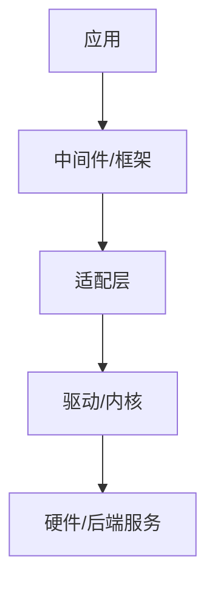

# 排查沉淀文档

## 一、先明确写给谁

三类读者，写法要同时满足：

| 读者 | 只关心 | 对文档的要求 |
|---|---|---|
| 半年后的自己 | 卡点在哪、当时怎么验证的 | 命令和输出要能直接复制重跑 |
| 接手/相似现象的同事 | 我这个现象是不是同一个根因 | 现象描述要具体到错误文案和伴生表现 |
| 上游（BSP、供应商、其他域） | 证据链和责任边界 | 每层结论都要有验证手段，不能是"我觉得" |

由此得出三条硬规则：

1. **结论先行，不写时间流水账。** 不要按"我先试了A，又试了B，然后C"的顺序写，按分层顺序重排。
2. **每个结论后面挂证据。** 命令 + 关键输出，别只写"确认正常"。
3. **实测和推测必须分开标注。** 推测写"待验证"，不能和已确认事实混在一段里用肯定语气。

## 二、动笔前先补齐信息

对话里缺哪条就问哪条，具体到"跑哪条命令、看哪个文件"，不要自己脑补：

- 完整错误信息原文（不是转述）
- 伴生现象有哪些（同时出现的异常、只在某些条件下出现的异常）
- 每层是用什么手段验证的，原始输出是什么
- 哪些实验做了但**没有**复现问题（这些是排除项，同样要写）
- 最终是自己改的、上游改的、还是绕行方案
- 有没有当时误判过的干扰项

## 三、固定模板

严格用这七节，标题可微调，顺序不动。

```markdown
# [一句话问题描述：什么场景下，什么组件，什么表现]

## 1. 故障现象
## 2. 排查思路
## 3. 逐层排查过程与证据
## 4. 完整因果链
## 5. 各层状态总结
## 6. 结论与行动
## 7. 方法论沉淀
```

### 1. 故障现象

- 错误信息**原文照抄**，放代码块，不要润色不要翻译。
- 单列"伴生现象"清单：跟主报错同时出现的其它异常。这是后来判断干扰项/同源问题的依据。
- 补上触发条件：什么操作能稳定复现，什么情况下不出现。

```markdown
**主报错**
​```
<原文>
​```

**伴生现象**
| # | 现象 | 是否与主问题同源 |
|---|---|---|
| 1 | ... | 是 / 否（干扰项）/ 待定 |

**复现条件**：...
**不复现条件**：...
```

"不复现条件"往往比复现条件信息量更大，别省。

### 2. 排查思路

写方法论，不写具体实验。两部分：

- **分层图**：把链路从最上层拆到最下层。程序问题按调用栈/软件栈分层，非程序问题按流程环节分层。
- **核心方法**：一句话说明为什么这么排。

分层图用 mermaid，同时保证纯文本可读（会被贴进邮件、wiki、工单）：



固定要写进这一节的判断前提（几乎每次排查都成立，值得每份文档重申）：

- 上层报错文案不可信，它只反映上层看到的失败，不反映根因。
- 自上而下逐层排除，每层只回答一个问题：**这一层的输入正常吗？这一层的输出正常吗？**

### 3. 逐层排查过程与证据

每层一个小节，每个小节一张表或一个命令块，三列固定：**实验 / 结果 / 结论**。

```markdown
### 3.2 GStreamer 层

| 实验 | 结果 | 结论 |
|---|---|---|
| `gst-inspect-1.0 xxx` | 插件加载正常 | 插件本身没问题 |
| 换 fakesink 跑 | 不再报错 | 问题在 sink 侧，不在 pipeline 前段 |
```

要求：

- 命令原样贴，能复制就能重跑。关键输出截取几行放代码块，长日志只留判定行。
- **失败的、无结果的实验也要写**。它们构成排除项，是文档最省时间的部分。
- 每层末尾给一句"本层结论"，明确是"排除"还是"命中"。

### 4. 完整因果链

一张图，展示根因如何一路传导到用户看到的报错。方向从**根因指向表象**，跟第 2 节的排查方向相反——这一节是"复盘后重述"，不是"排查过程"。

```
[根因: 底层服务未就绪]
        ↓
[驱动 probe 成功但 ioctl 无响应]
        ↓
[适配层超时，返回通用错误码]
        ↓
[上层报出与根因无关的文案]
```

如果存在多条路径表现不同（不同硬件通路、不同参数、不同机型），加一张对照表：

| 路径 | 表现 | 原因 |
|---|---|---|
| 路径 A | 报错退出 | ... |
| 路径 B | 直接挂死 | ... |

这张对照表是给同事按现象反查根因用的，价值很高，有就一定写。

### 5. 各层状态总结

全链路一张表，一眼看清卡点位置。这是给上游看的核心页。

| # | 层 | 状态 | 验证手段 |
|---|---|---|---|
| 1 | 应用 | ✅ 正常 | `<命令>` |
| 2 | ... | ✅ 正常 | ... |
| 5 | ... | ❌ 卡在此处 | `<命令>` + 关键输出 |

规则：状态只有 ✅ / ❌ / ⚠️（待确认）三种；**每一行都必须有验证手段**，填不出来的就标 ⚠️，不许留空也不许写"应该没问题"。

### 6. 结论与行动

三块，缺一不可：

- **根因**：一句话，落到具体组件和具体机制。
- **需要谁做什么**：给上游/BSP/供应商的反馈要点，写成他们能直接复现的形式（现象 + 命令 + 期望行为 + 实际行为）。
- **当前可用的绕行方案**：以及绕行的代价（性能、功能缺失、适用范围）。没有绕行方案就写"无，阻塞中"。

### 7. 方法论沉淀

这一节决定文档半年后还有没有价值。每条经验写成**可迁移的判断规则**，不是感想。

固定格式：

```markdown
- **<一句话规则>**
  本次表现：...
  下次遇到怎么用：...
```

要求：

- 5～8 条，宁少勿凑。
- 每条必须是"下次遇到别的问题也能用"的规则。类似 "probe 成功 ≠ 服务可用"、"日志缓冲区满了会丢关键行，先扩缓冲再复现"、"两个同时出现的异常先按无关处理，别急着并成一个根因"。
- 禁止空话："要细心"、"要多看文档"、"沟通很重要" 这类一律删掉。
- 把当时的误判单独写一条：曾经怀疑过什么、为什么排除了。这是防止下次重走弯路最有效的一条。

## 四、非程序问题怎么套这个模板

模板不变，只换"分层"的含义：

| 程序问题 | 非程序问题 |
|---|---|
| 软件栈分层（应用→框架→驱动→硬件） | 流程环节分层（需求→排期→交付→验收） |
| 命令与日志 | 邮件、会议纪要、工单记录、时间点 |
| 各层状态表 | 各环节状态表（谁负责、卡在谁那、依据是什么） |
| 复现条件 | 触发条件（哪种情况下必出问题） |

判定原则不变：**上层反馈的问题描述不可信，逐环节找第一个断点，每个环节结论都要有证据（记录、截图、原话）。**

## 五、输出形式

- 生成 Markdown 文件，别只在对话里贴。
- 文件名：`<日期>-<组件>-<一句话现象>.md`，例如 `2026-09-10-vpu-hevc-decode-hang.md`。
- 表格和图要在纯文本下可读，它们会被贴进工单和邮件。
- 敏感信息（内部路径、序列号、客户名）在给外部的版本里替换掉，并在文档里注明替换过。

## 六、交付前自查

- [ ] 第 1 节的报错是原文，不是转述？
- [ ] 每层结论后面都有命令/输出/记录作为证据？
- [ ] 排除项（试过但没复现的实验）写进去了吗？
- [ ] 第 5 节状态表每一行都有验证手段，没有空白？
- [ ] 推测和实测有没有混在一起写成肯定语气？
- [ ] 第 4 节因果链方向是"根因 → 表象"，不是排查顺序？
- [ ] 第 7 节每条经验都是可迁移规则，没有空话？
- [ ] 有没有把误判/干扰项记下来？
- [ ] 全文有没有"之前我以为...后来改成..."的流水叙事？有就重排成结论式。
